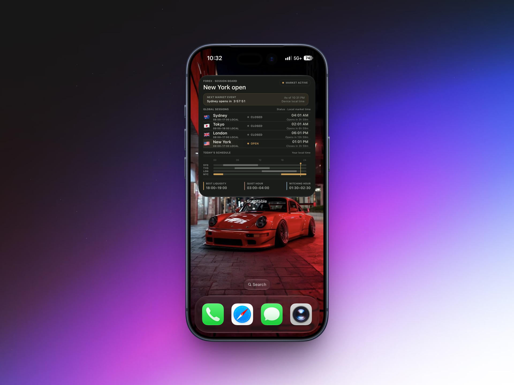
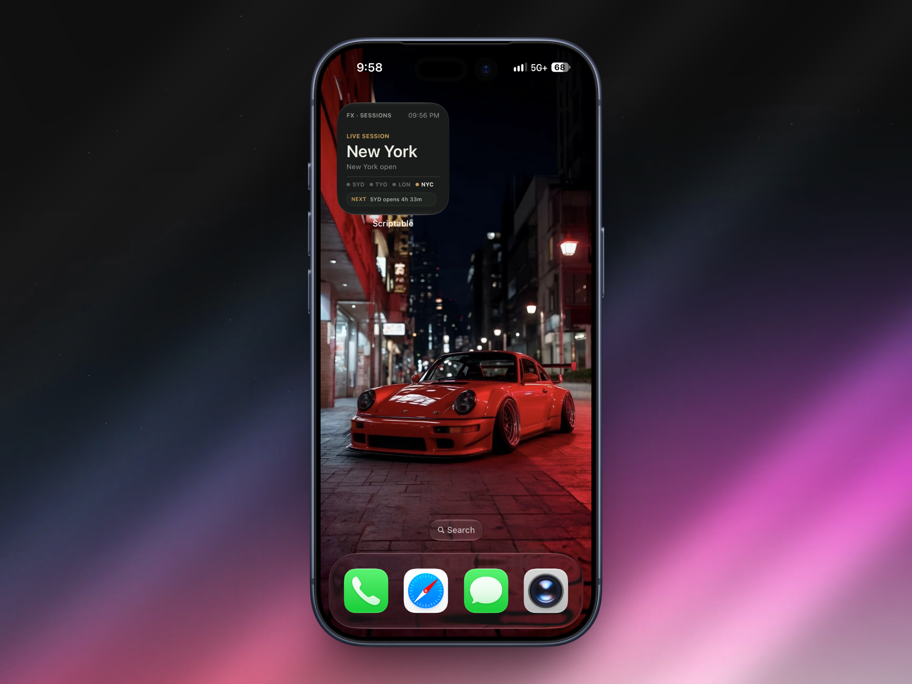
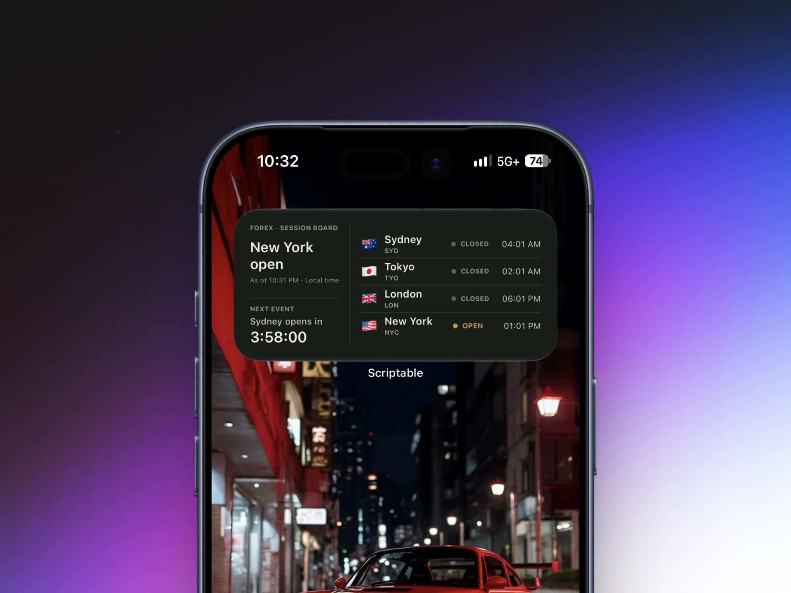
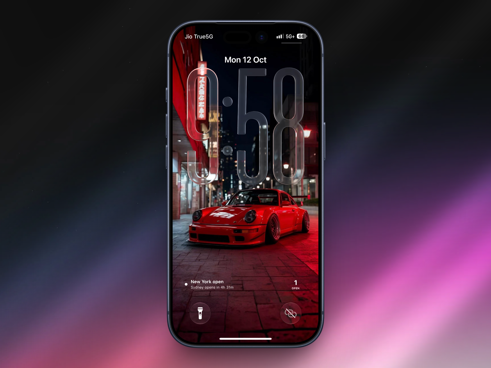

# FX Market Clock

[](https://scriptable.app)
[](https://www.apple.com/ios/)
[](LICENSE.txt)

A premium-style Scriptable widget for iOS that tracks the four major foreign exchange sessions in real time: Sydney, Tokyo, London, and New York.

It surfaces the current market state, next open/close event, 24-hour session schedule in local time, and liquidity-focused windows such as the best liquidity period, quietest hour, and the New York “witching” hour.

This is built for traders, market participants, and anyone who wants a quick read on global FX market activity from their Home Screen or Lock Screen.

---

## Overview

FX Market Clock is a single-file Scriptable widget designed to run on iPhone and iPad without needing any backend, API key, or server.

Instead of fetching live market data from a remote service, it calculates the current market phase from session timing rules, local time zones, and market calendar logic. That means it remains lightweight, private, and reliable while still capturing the essentials of global FX market behavior.

The widget is especially useful for:

- Monitoring which FX sessions are open right now
- Seeing when the next market open or close will happen
- Viewing the full 24-hour schedule in your local time
- Identifying the strongest or quietest liquidity windows
- Checking daylight-saving-time-safe session timing on the fly

---

## Features

- Live detection of open and closed status for Sydney, Tokyo, London, and New York
- Countdown to the next session open or close
- Visual 24-hour market timeline aligned to your device’s local time
- Best liquidity window, quiet hour, and NY witching-hour markers
- Automatic light/dark mode compatibility via the device appearance
- Correct handling of:
  - daylight saving time
  - weekend market closure
  - Christmas Day and New Year’s Day closures
  - Good Friday for London and Sydney trading sessions
- Works across Home Screen and Lock Screen widget sizes
- No configuration required for normal use
- Fully self-contained in a single JavaScript file

---

## Screenshots

<p align="center">
  
</p>

<table>
  <tr>
    <td align="center" width="50%">
      <br>
      <sub><strong>Small</strong></sub>
    </td>
    <td align="center" width="50%">
      <br>
      <sub><strong>Medium</strong></sub>
    </td>
  </tr>
</table>

<p align="center">
  <br>
  <sub><strong>Lock Screen</strong></sub>
</p>

---

## Supported Widget Sizes

| Size | Supported |
| --- | :---: |
| Small | ✅ |
| Medium | ✅ |
| Large | ✅ |
| Lock Screen – Rectangular | ✅ |
| Lock Screen – Circular | ✅ |
| Lock Screen – Inline | ✅ |

---

## How It Works

The widget models the session timing using time-zone-aware calculations rather than fixed UTC assumptions.

Each session is defined with:

- city name
- short code
- time zone
- local open time
- local close time
- relative weighting used to estimate daily liquidity

For each session, the script computes:

- the UTC offset for that market at the current time
- the opening and closing boundaries in UTC
- whether the session is currently open
- the next scheduled open/close boundary
- whether the market is affected by weekend or holiday closure rules

### Market logic

The widget uses a few explicit rules to determine whether the market is active:

- FX is closed from Friday 17:00 New York time through Sunday 17:00 New York time
- Christmas Day is treated as a global closure
- New Year's Day is treated as a global closure
- Good Friday is treated as a closure for London and Sydney

This is implemented in JavaScript using the system’s time-zone and date APIs so the widget will stay consistent across DST transitions and international market calendars.

### Session weighting and liquidity windows

The script assigns approximate market activity weights to each session:

- Sydney: 0.06
- Tokyo: 0.19
- London: 0.43
- New York: 0.32

These weights are used to estimate where the market is busiest and quietest over the day. The widget highlights:

- Best liquidity hour: highest combined volume window
- Quiet hour: lowest combined volume window
- Witching hour: late New York close period, used as a FX market timing reference

---

## Installation

1. Install the free [Scriptable](https://apps.apple.com/app/scriptable/id1405459188) app from the App Store.
2. Open Scriptable.
3. Tap the `+` button to create a new script.
4. Paste the full contents of `widget.js` into the editor.
5. Save the script with a name such as `FX Market Clock`.
6. Add a Scriptable widget to your Home Screen or Lock Screen.
7. Tap the widget and select the script you just created.

No parameters are required under normal use. The script automatically uses the device’s local timezone and system light/dark appearance.

---

## Preview and Testing

The script includes a preview mode for testing directly inside Scriptable.

At the top of `widget.js`, you can adjust:

```js
const PREVIEW_FAMILY = 'large';
// 'small' | 'medium' | 'large' | 'accessoryRectangular' | 'accessoryCircular' | 'accessoryInline'

const THEME_OVERRIDE = null;
// null = follow system | 'light' | 'dark'
```

This is useful when you want to:

- preview a specific widget size
- test dark mode and light mode rendering
- verify layout behavior before placing it on your Home Screen

---

## Project Structure

```text
FX-Market-Clock/
├── LICENSE.txt
├── README.md
├── widget.js
├── assets/
│   ├── large-mockup.png
│   ├── medium-mockup.png
│   ├── small-mockup.png
│   └── lockscreen-mockup.png
└── ...
```

- `widget.js` — the complete widget implementation
- `assets/` — mockup images used in the documentation
- `LICENSE.txt` — project licensing terms
- `README.md` — usage and project documentation

---

## Customization

The widget styling is centralized in the theme block at the top of `widget.js`.

You can tailor the appearance by editing the color values defined in `C`:

```js
const C = {
  surface: themed('#F5F3ED', '#191C1A'),
  surfaceRaised: themed('#FBFAF6', '#1F2320'),
  ink: themed('#1D211F', '#EEECE4'),
  inkSoft: themed('#3F4441', '#C6C6BD'),
  muted: themed('#777C77', '#90958F'),
  accent: themed('#9A7135', '#C59A57'),
  // ...
};
```

This lets you change the visual language while keeping the existing layout intact.

---

## Why Use This Widget?

Unlike generic time widgets, FX Market Clock is purpose-built around the rhythm of global financial markets.

It gives you a quick, glanceable overview of:

- when the market is open or closed
- where overlap is occurring across trading sessions
- when the next key event will happen
- which periods are likely to offer better liquidity conditions

For many users, this is a more meaningful view than a simple clock because it reflects the actual operational behavior of the FX market across the 24-hour trading cycle.

---

## License

This project is distributed under the MIT License. See [`LICENSE.txt`](LICENSE.txt) for the full text.

---

## Notes

This repository is intentionally lightweight and focused. It is designed to be easy to understand, easy to customize, and easy to drop into Scriptable for daily use.

If you want a different visual theme, alternate session definitions, or more explicit trading-day logic, the implementation is already structured so those changes can be made in one place without redesigning the widget.

---

## Acknowledgements

- [Scriptable](https://scriptable.app) for the widget runtime and app platform
- The global forex market schedule model used in this widget for session timing and liquidity interpretation
- The open-source community for inspiration around widget design and market visualizations
