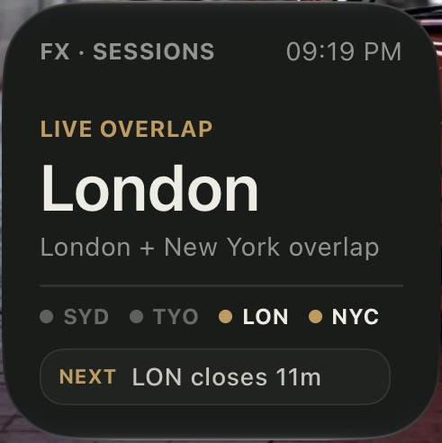
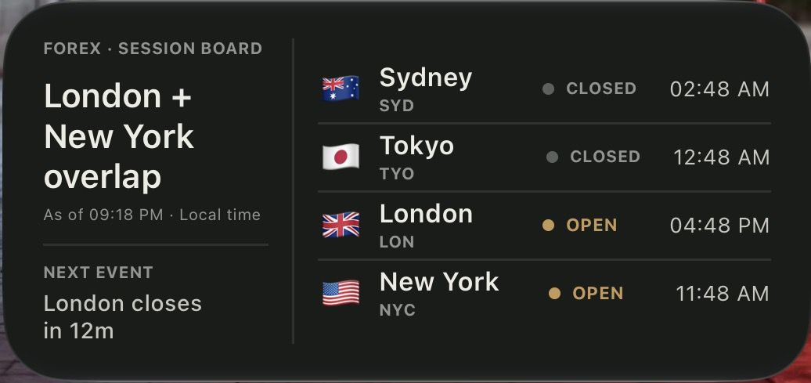
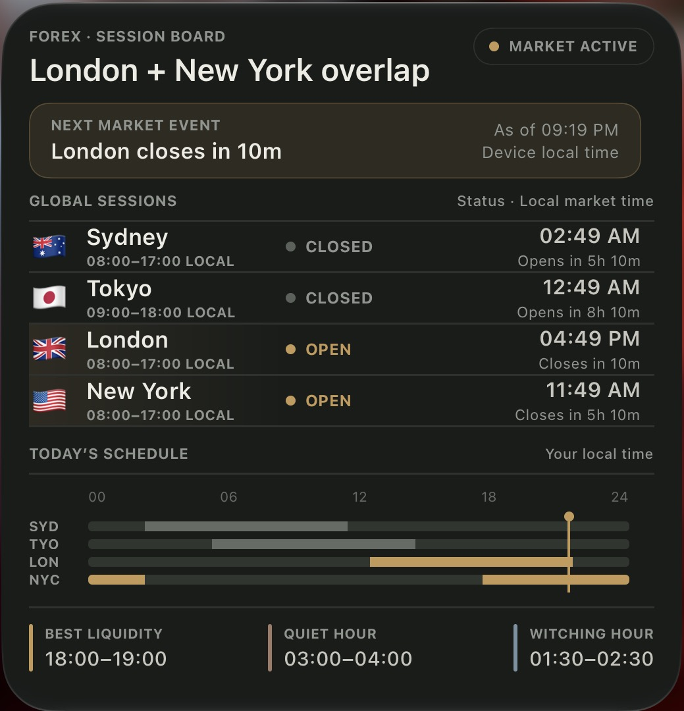
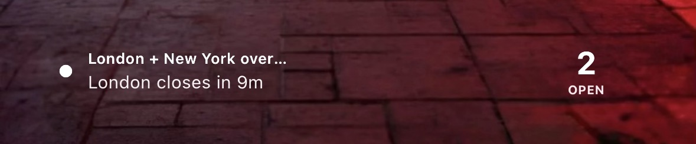

# Forex Session Board

[](https://scriptable.app)
[](LICENSE.txt)
[](https://www.apple.com/ios/)

A clean and modern [Scriptable](https://scriptable.app) widget that shows the real-time status of the four major Forex sessions — **Sydney**, **Tokyo**, **London**, and **New York**.

---

### Features

- Live open/closed status for all four major FX sessions
- Next open / close countdown with precise timing
- Full 24-hour visual schedule in **your local time**
- Best liquidity hour, quietest hour, and NY “witching” hour
- Automatic Light / Dark mode support
- Correctly handles DST, weekends, and major holidays (Christmas, New Year, Good Friday)
- Works on both Home Screen and Lock Screen widgets

---

### Screenshots

<table>
  <tr>
    <td align="center" width="50%">
      <strong>Small</strong><br>
      
    </td>
    <td align="center" width="50%">
      <strong>Medium</strong><br>
      
    </td>
  </tr>
</table>

<br>

<p align="center">
  <strong>Large</strong><br>
  
</p>

<br>

<p align="center">
  <strong>Lock Screen</strong><br>
  
</p>

---

### Supported Widget Sizes

| Size                        | Supported |
|-----------------------------|:---------:|
| Small                       | ✅        |
| Medium                      | ✅        |
| Large                       | ✅        |
| Lock Screen – Rectangular   | ✅        |
| Lock Screen – Circular      | ✅        |
| Lock Screen – Inline        | ✅        |

---

### Installation

1. Install the free **[Scriptable](https://apps.apple.com/app/scriptable/id1405459188)** app from the App Store.
2. Open Scriptable → tap **+** → paste the contents of [`widget.js`](widget.js).
3. Name the script (e.g. “Forex Sessions”).
4. Long-press your Home Screen → **+** → search for **Scriptable** → choose a size.
5. Tap the widget → select the script you just created.

No parameters needed. The widget automatically uses your device’s local time zone and system appearance (Light/Dark).

---

### Preview & Testing

You can change these values at the top of the script while testing:

```js
const PREVIEW_FAMILY = 'large';
// 'small' | 'medium' | 'large' | 'accessoryRectangular' | 'accessoryCircular' | 'accessoryInline'

const THEME_OVERRIDE = null;
// null = follow system | 'light' | 'dark'